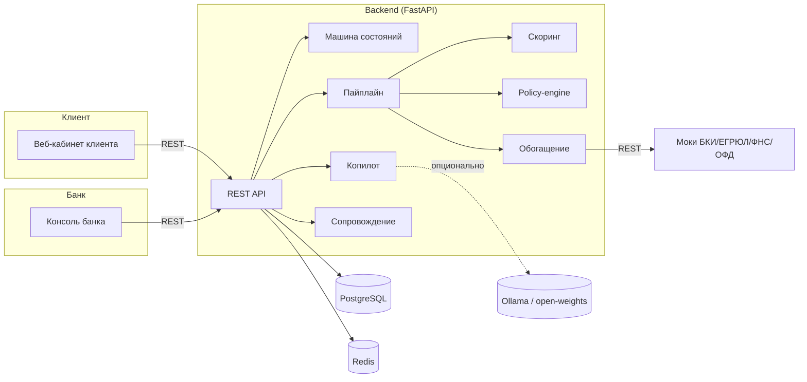
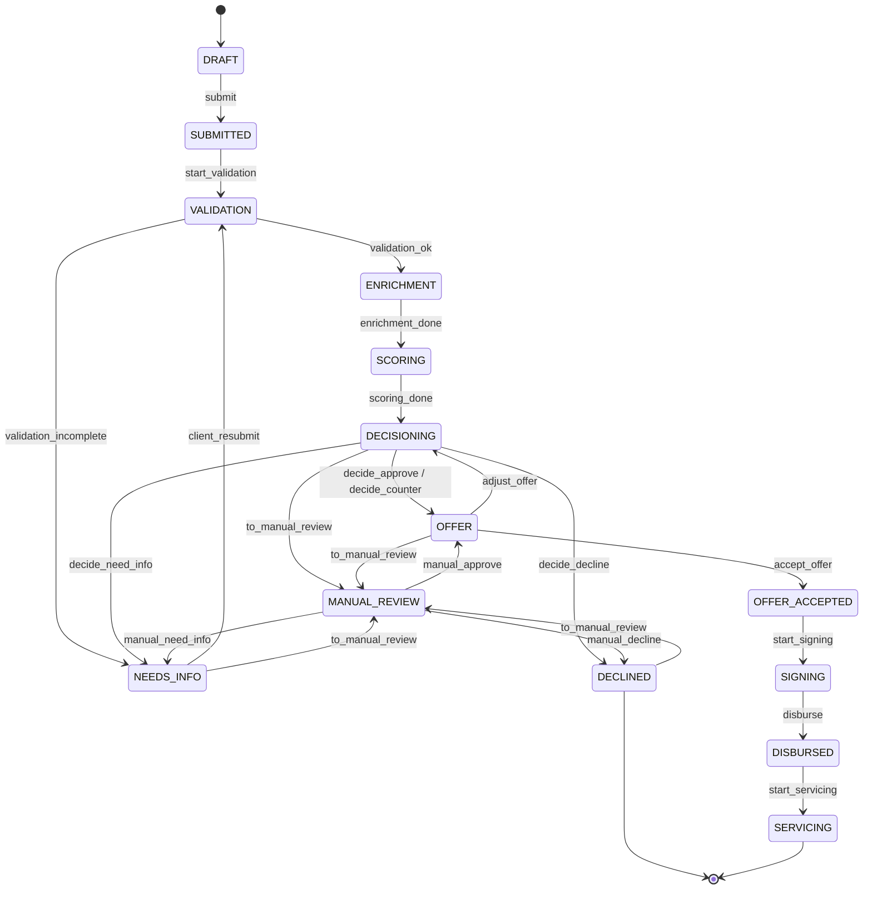
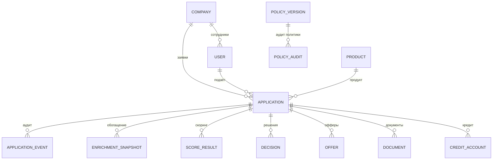

> После интеграции единственный frontend — `../../src`, запуск — корневой `compose.yaml`. Доменные диаграммы ниже сохранены; изменения описаны в `../../docs/integration-matrix.md`.

# Архитектура решения

## Обзор

Цифровой кредитный конвейер для малого и микробизнеса. Один продукт обслуживает
две стороны — клиента и банк — поверх общего движка принятия решения и единой
машины состояний заявки.



## Компоненты

- **frontend** — React + TypeScript + Vite, две ролевые зоны (клиент, банк).
- **backend** — FastAPI: REST API, машина состояний, пайплайн, скоринг,
  policy-engine, копилот, сопровождение.
- **integrations-mock** — симуляторы внешних источников (БКИ, ЕГРЮЛ/ЕГРИП,
  ФНС «Прозрачный бизнес», ОФД) с упрощёнными контрактами.
- **postgres** — основное хранилище. **redis** — кэш и фоновые задачи.
- **ollama** (опционально) — LLM с открытыми весами для копилота.

## Сквозной пайплайн

```
потребность → продукт → заявка → проверки → обогащение → скоринг → политика
   → (одобрение / контрусловия / запрос данных / отказ) → подписание → выдача → сопровождение
```

Скоринг и решение разделены: скоринг даёт балл риска с факторами, policy-engine
превращает балл вместе с правилами банка в решение и условия.

## Машина состояний заявки



Автоматические переходы (валидация, обогащение, скоринг, решение) выполняет
пайплайн; ручные — клиент (отправка, приём оффера, переотправка) и банк
(подписание, выдача, ручной разбор).

## Модель данных (ERD)



## Enterprise-аспекты

- **Безопасность:** JWT + RBAC (клиентские и банковские роли), аудит переходов
  и изменений политики, секреты в переменных окружения.
- **Надёжность:** healthcheck у сервисов, устойчивые вызовы моков (таймаут,
  ошибка источника не роняет пайплайн), деградация копилота в шаблоны без LLM.
- **Воспроизводимость:** Docker Compose, зафиксированные версии зависимостей,
  синтетический сид, миграции Alembic.
- **Масштабирование:** сервисы stateless, состояние в Postgres/Redis; путь роста —
  вынести скоринг/копилот/интеграции в отдельные сервисы, очередь на Kafka, k8s.
```

## Enterprise-слой и сопровождение

### Раннее предупреждение

После `DISBURSED → SERVICING` backend создаёт `CreditAccount`. Сервис сопровождения
строит дневной прогноз на 60 дней по выручке, обязательным расходам, налогам,
зарплате, платежу по кредиту и подтверждаемой дебиторке. При отрицательном остатке
радар фиксирует дату и размер разрыва, а затем сравнивает варианты помощи через тот же
forecast-движок.

### Дебиторка и цепочная зараза

Контрагенты проверяются локальным `integrations-mock`. Ликвидация и блокировка счёта
помечают дебиторку рискованной; такая сумма исключается из надёжного прогноза. Это
предотвращает выдачу нового долга на основании денег, которые бизнес, вероятно, не
получит.

### Автопилот

Автопилот хранит настройки и журнал в `CreditAccount.autopilot`. Бесплатные и заранее
разрешённые действия могут применяться автоматически. Предодобренный мост ограничен
`max_bridge`; превышение лимита не выполняется автоматически и требует решения человека.

### Банковский портфель

`/portfolio/early-warnings` собирает кредиты с прогнозируемым разрывом или нарушением
ковенантов. `/portfolio/metrics` показывает размер портфеля, сумму под риском, долю
превентивных действий и модельный эффект на 30+ DPD. Поэтому клиентский сигнал и
портфельная очередь используют одну модель и один источник состояния.

### Границы прототипа

Подписание, выдача, банковские транзакции и обновление внешних источников моделируются.
В промышленной версии к этому слою добавляются scheduler/queue, outbox, circuit
breaker, idempotency keys, correlation IDs и наблюдаемость.
