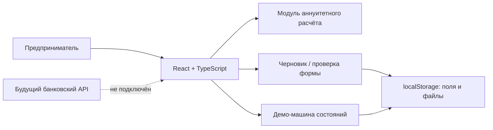
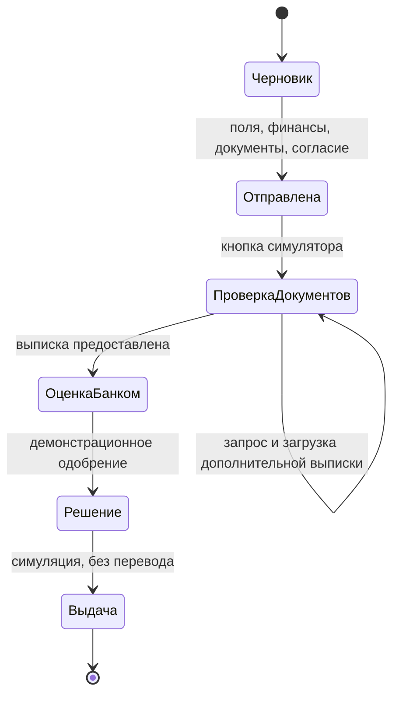

> Исторический документ этапа проектирования. После интеграции 26.10.2026 актуальны `README.md`, `docs/integration-matrix.md` и `docs/openapi.json`. Локальные заглушки, упомянутые ниже, заменены рабочим API.

# Архитектура и интеграционные границы

## Состояния

## Модель данных

`Draft`: amount, rate, months, profit, delay, purpose; company, inn, type (ИП/ООО), name, email; revenue, expenses; step (0–3), consent; docs (идентификатор → name, data, size); status (-1 черновик, 0–4 этапы); submitted (ISO timestamp); notifications (последние 12 сообщений).

Источник истины — React state; каждое изменение сохраняется в localStorage. Файлы включены в черновик в виде Data URL. Функция calculate чистая и вынесена отдельно. Документы зависят от формы бизнеса. Заявка блокируется до заполнения всех шагов. После отправки форма доступна через трекер, удаление исходных документов заблокировано.

## API

HTTP API в этом фронтенд-прототипе не реализован. Запросы к банковским сервисам не выполняются. Полный проект контракта v1 и готовое задание для FastAPI описаны в [BACKEND_CODEX_PROMPT.md](BACKEND_CODEX_PROMPT.md). Он является источником истины для будущей интеграции; таблица ниже — краткое содержание, а не доступные эндпоинты.

| Метод | Путь | Назначение |
|---|---|---|
| POST | /api/v1/applications | Создать черновик |
| PATCH | /api/v1/applications/{id} | Сохранить данные и шаг |
| POST | /api/v1/applications/{id}/documents | Загрузить документ с проверкой |
| POST | /api/v1/applications/{id}/submit | Повторная серверная проверка и отправка |
| GET | /api/v1/applications/{id} | Состояние, запросы документов и сроки |
| GET | /api/v1/applications/{id}/events | JSON-история событий; текущее состояние заявки опрашивается каждые 5 секунд |

Для рабочего решения потребуются авторизация, серверная валидация, идемпотентная отправка, журнал переходов, зашифрованное файловое хранилище и интеграция с банком. Фронтенд не должен принимать решение по кредиту.

## Связь с исследованием

Предоставленные скриншоты содержат 7 общих ответов, 5 ответов в вопросах о кредитном опыте и 4 ответа о желаемых функциях. Это малая исследовательская выборка, не репрезентативная статистика. Отмеченные проблемы высокой ставки, сбора документов, исправлений и необходимости сопровождения отражены в калькуляторе, проверке анкеты, локальном сохранении, объяснениях этапов и справке. Связь с реальным менеджером требует бэкенда и не имитируется чат-ботом.

## Кредитная лаборатория (2026-10-23)

`src/lab/InnovationHub.tsx` — семь новых экранов в двух демо-ролях. `engine.ts` — общий движок учебных правил, контрпредложений, симуляции портфеля и арифметических прогнозов; `store.ts` — разделяемое между экранами локальное состояние. `lab.css` — адаптивные компоненты. Использован настоящий Alfa Core DS Button. Исходная пользовательская анкета и четыре синтетических компании намеренно имеют отдельные идентификаторы и хранилища; демо-решение не относится к введённым пользователем финансовым данным. Транспорт и ML пока отсутствуют. Новые серверные ресурсы описаны в `innovation-contract.md`.
